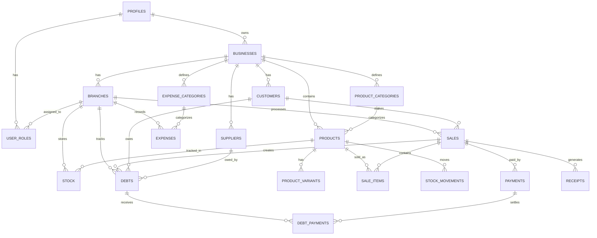

# DATABASE.md — Afri_BMS Database Reference

> Complete database reference for both Isar (local) and Supabase PostgreSQL (cloud).

---

## 1. Entity Relationship Diagram



---

## 2. Table Specifications

### 2.1 profiles

| Column | Type | Constraints | Description |
|---|---|---|---|
| id | UUID | PK, FK → auth.users | Supabase Auth user ID |
| email | TEXT | NOT NULL | User email |
| full_name | TEXT | NOT NULL | Display name |
| phone | TEXT | | Phone number |
| avatar_url | TEXT | | Profile picture URL |
| is_active | BOOLEAN | DEFAULT true | Account status |
| created_at | TIMESTAMPTZ | DEFAULT now() | Creation timestamp |
| updated_at | TIMESTAMPTZ | DEFAULT now() | Last update |
| deleted_at | TIMESTAMPTZ | | Soft delete timestamp |

### 2.2 businesses

| Column | Type | Constraints | Description |
|---|---|---|---|
| id | UUID | PK | Business identifier |
| owner_id | UUID | FK → profiles, NOT NULL | Business owner |
| name | TEXT | NOT NULL | Business name |
| description | TEXT | | Business description |
| logo_url | TEXT | | Logo in Supabase Storage |
| default_currency | TEXT | NOT NULL, DEFAULT 'NGN' | Primary currency |
| supported_currencies | TEXT[] | DEFAULT '{NGN}' | Array of currency codes |
| tax_rate | DECIMAL(5,2) | DEFAULT 0.00 | Default tax percentage |
| address | TEXT | | Physical address |
| phone | TEXT | | Business phone |
| email | TEXT | | Business email |
| is_active | BOOLEAN | DEFAULT true | Active status |
| subscription_tier | TEXT | DEFAULT 'free' | free, pro, enterprise |
| created_at | TIMESTAMPTZ | DEFAULT now() | |
| updated_at | TIMESTAMPTZ | DEFAULT now() | |
| deleted_at | TIMESTAMPTZ | | |

### 2.3 branches

| Column | Type | Constraints | Description |
|---|---|---|---|
| id | UUID | PK | Branch identifier |
| business_id | UUID | FK → businesses, NOT NULL | Parent business |
| name | TEXT | NOT NULL | Branch name |
| address | TEXT | | Branch address |
| phone | TEXT | | Branch phone |
| currency | TEXT | NOT NULL, DEFAULT 'NGN' | Branch currency |
| is_main | BOOLEAN | DEFAULT false | Main/HQ branch flag |
| is_active | BOOLEAN | DEFAULT true | Active status |
| created_at | TIMESTAMPTZ | DEFAULT now() | |
| updated_at | TIMESTAMPTZ | DEFAULT now() | |
| deleted_at | TIMESTAMPTZ | | |

### 2.4 user_roles

| Column | Type | Constraints | Description |
|---|---|---|---|
| id | UUID | PK | Role assignment ID |
| user_id | UUID | FK → profiles, NOT NULL | User being assigned |
| business_id | UUID | FK → businesses, NOT NULL | Business context |
| branch_id | UUID | FK → branches | NULL = all branches |
| role | TEXT | NOT NULL, CHECK | admin, branch_manager, salesperson, cashier, custom |
| custom_permissions | JSONB | DEFAULT '{}' | Custom permission flags |
| is_active | BOOLEAN | DEFAULT true | Active status |
| created_at | TIMESTAMPTZ | DEFAULT now() | |
| updated_at | TIMESTAMPTZ | DEFAULT now() | |
| deleted_at | TIMESTAMPTZ | | |

**Unique constraint**: (user_id, business_id, branch_id)

### 2.5 products

| Column | Type | Constraints | Description |
|---|---|---|---|
| id | UUID | PK | Product identifier |
| business_id | UUID | FK → businesses, NOT NULL | Owning business |
| category_id | UUID | FK → product_categories | Product category |
| name | TEXT | NOT NULL | Product name |
| description | TEXT | | Product description |
| sku | TEXT | | Stock Keeping Unit |
| barcode | TEXT | | EAN/UPC barcode value |
| cost_price | BIGINT | NOT NULL, DEFAULT 0 | Cost in minor units |
| selling_price | BIGINT | NOT NULL, DEFAULT 0 | Sell price in minor units |
| currency | TEXT | NOT NULL, DEFAULT 'NGN' | Currency code |
| unit | TEXT | DEFAULT 'pcs' | pcs, kg, litre, etc. |
| reorder_level | INT | DEFAULT 10 | Low stock threshold |
| is_active | BOOLEAN | DEFAULT true | Active/archived |
| image_urls | TEXT[] | | Array of image URLs |
| created_at | TIMESTAMPTZ | DEFAULT now() | |
| updated_at | TIMESTAMPTZ | DEFAULT now() | |
| deleted_at | TIMESTAMPTZ | | |

### 2.6 stock

| Column | Type | Constraints | Description |
|---|---|---|---|
| id | UUID | PK | Stock record ID |
| product_id | UUID | FK → products, NOT NULL | Product |
| variant_id | UUID | FK → product_variants | Specific variant |
| branch_id | UUID | FK → branches, NOT NULL | Branch location |
| quantity | INT | NOT NULL, DEFAULT 0 | Current quantity |
| batch_number | TEXT | | Batch identifier |
| expiry_date | DATE | | Expiration date |
| created_at | TIMESTAMPTZ | DEFAULT now() | |
| updated_at | TIMESTAMPTZ | DEFAULT now() | |

**Unique constraint**: (product_id, variant_id, branch_id, batch_number)

### 2.7 sales

| Column | Type | Constraints | Description |
|---|---|---|---|
| id | UUID | PK | Sale identifier |
| business_id | UUID | FK → businesses, NOT NULL | Business |
| branch_id | UUID | FK → branches, NOT NULL | Branch |
| customer_id | UUID | FK → customers | Customer (optional) |
| sold_by | UUID | FK → profiles, NOT NULL | Salesperson/cashier |
| sale_number | TEXT | NOT NULL | Auto-gen: INV-0001 |
| subtotal | BIGINT | NOT NULL, DEFAULT 0 | Before discounts/tax |
| discount_amount | BIGINT | DEFAULT 0 | Discount value |
| discount_type | TEXT | CHECK | fixed, percentage |
| tax_amount | BIGINT | DEFAULT 0 | Tax value |
| total_amount | BIGINT | NOT NULL, DEFAULT 0 | Final amount |
| currency | TEXT | NOT NULL, DEFAULT 'NGN' | Currency |
| payment_status | TEXT | NOT NULL, CHECK | paid, partial, unpaid, refunded |
| notes | TEXT | | Sale notes |
| created_at | TIMESTAMPTZ | DEFAULT now() | |
| updated_at | TIMESTAMPTZ | DEFAULT now() | |
| deleted_at | TIMESTAMPTZ | | |

### 2.8 debts

| Column | Type | Constraints | Description |
|---|---|---|---|
| id | UUID | PK | Debt identifier |
| business_id | UUID | FK → businesses, NOT NULL | Business |
| branch_id | UUID | FK → branches, NOT NULL | Branch |
| debt_type | TEXT | NOT NULL, CHECK | receivable (customer owes), payable (business owes) |
| customer_id | UUID | FK → customers | For receivables |
| supplier_id | UUID | FK → suppliers | For payables |
| sale_id | UUID | FK → sales | Related sale |
| original_amount | BIGINT | NOT NULL | Initial debt amount |
| outstanding_amount | BIGINT | NOT NULL | Remaining balance |
| currency | TEXT | NOT NULL, DEFAULT 'NGN' | Currency |
| due_date | DATE | | Payment due date |
| status | TEXT | NOT NULL, CHECK | active, partially_paid, paid, overdue, written_off |
| notes | TEXT | | Debt notes |
| created_at | TIMESTAMPTZ | DEFAULT now() | |
| updated_at | TIMESTAMPTZ | DEFAULT now() | |
| deleted_at | TIMESTAMPTZ | | |

---

## 3. Indexes

### Critical Indexes for Query Performance

```sql
-- Products: search by business + name
CREATE INDEX idx_products_business_name ON products(business_id, name);
CREATE INDEX idx_products_barcode ON products(barcode) WHERE barcode IS NOT NULL;
CREATE INDEX idx_products_sku ON products(sku) WHERE sku IS NOT NULL;

-- Stock: lookup by product + branch
CREATE INDEX idx_stock_product_branch ON stock(product_id, branch_id);
CREATE INDEX idx_stock_low ON stock(quantity) WHERE quantity > 0;

-- Sales: date-range queries
CREATE INDEX idx_sales_branch_date ON sales(branch_id, created_at DESC);
CREATE INDEX idx_sales_customer ON sales(customer_id) WHERE customer_id IS NOT NULL;

-- Debts: active debts
CREATE INDEX idx_debts_active ON debts(business_id, status) WHERE status != 'paid';
CREATE INDEX idx_debts_overdue ON debts(due_date) WHERE status = 'active';

-- Payments: by sale
CREATE INDEX idx_payments_sale ON payments(sale_id);

-- Sync: unsynced records (Isar-side)
-- All collections have idx on isSynced + localUpdatedAt
```

---

## 4. Monetary Values Convention

> **All monetary values are stored as BIGINT (int64) in minor currency units.**

| Currency | Major Unit | Minor Unit | Divisor | Example |
|---|---|---|---|---|
| NGN (₦) | Naira | Kobo | 100 | ₦1,250.50 → `125050` |
| GHS (GH₵) | Cedi | Pesewa | 100 | GH₵500.00 → `50000` |
| XOF (CFA) | Franc | Centime | 1 | CFA 5,000 → `5000` |
| USD ($) | Dollar | Cent | 100 | $99.99 → `9999` |

### Why minor units?

- **No floating point errors** — `0.1 + 0.2 ≠ 0.3` in doubles
- **Exact arithmetic** — integers are precise
- **Database friendly** — BIGINT comparisons are fast
- **Industry standard** — Stripe, Paystack, all payment APIs use minor units

---

## 5. Soft Delete Pattern

Every table with `deleted_at`:

```sql
-- Query active records (standard)
SELECT * FROM products WHERE deleted_at IS NULL;

-- "Delete" a record
UPDATE products SET deleted_at = now(), updated_at = now() WHERE id = $1;

-- Permanently purge (admin, rare)
DELETE FROM products WHERE deleted_at < now() - interval '90 days';
```

### Isar equivalent

```dart
// Query active
final active = await isar.products
    .filter()
    .deletedAtIsNull()
    .findAll();

// Soft delete
await isar.writeTxn(() async {
  product.deletedAt = DateTime.now();
  product.isSynced = false;
  await isar.products.put(product);
});
```

---

## 6. Custom Permissions Schema

The `custom_permissions` JSONB field in `user_roles`:

```json
{
  "inventory": {
    "view": true,
    "create": true,
    "edit": true,
    "delete": false
  },
  "sales": {
    "view": true,
    "create": true,
    "edit": false,
    "delete": false,
    "discount": true,
    "max_discount_percent": 15
  },
  "expenses": {
    "view": true,
    "create": true,
    "edit": false,
    "delete": false
  },
  "customers": {
    "view": true,
    "create": true,
    "edit": true,
    "delete": false
  },
  "suppliers": {
    "view": false,
    "create": false,
    "edit": false,
    "delete": false
  },
  "reports": {
    "view": false
  },
  "debt_credit": {
    "view": true,
    "create": false,
    "edit": false,
    "delete": false
  },
  "settings": {
    "view": false,
    "edit": false
  }
}
```

---

## 7. Supabase Storage Buckets

| Bucket | Contents | Access |
|---|---|---|
| `product-images` | Product photos | Authenticated read, admin/manager write |
| `receipts` | Generated PDF receipts | Authenticated read (own business) |
| `business-assets` | Logos, documents | Admin write, all business users read |
| `user-avatars` | Profile photos | Owner write, authenticated read |
| `barcode-labels` | Generated barcode/label images | Authenticated read |

### Path Convention

```
{bucket}/{business_id}/{sub_category}/{filename}

Examples:
product-images/uuid-123/products/prod-456_1696800000.jpg
receipts/uuid-123/2026/10/INV-2026-0042.pdf
business-assets/uuid-123/logo.png
```
